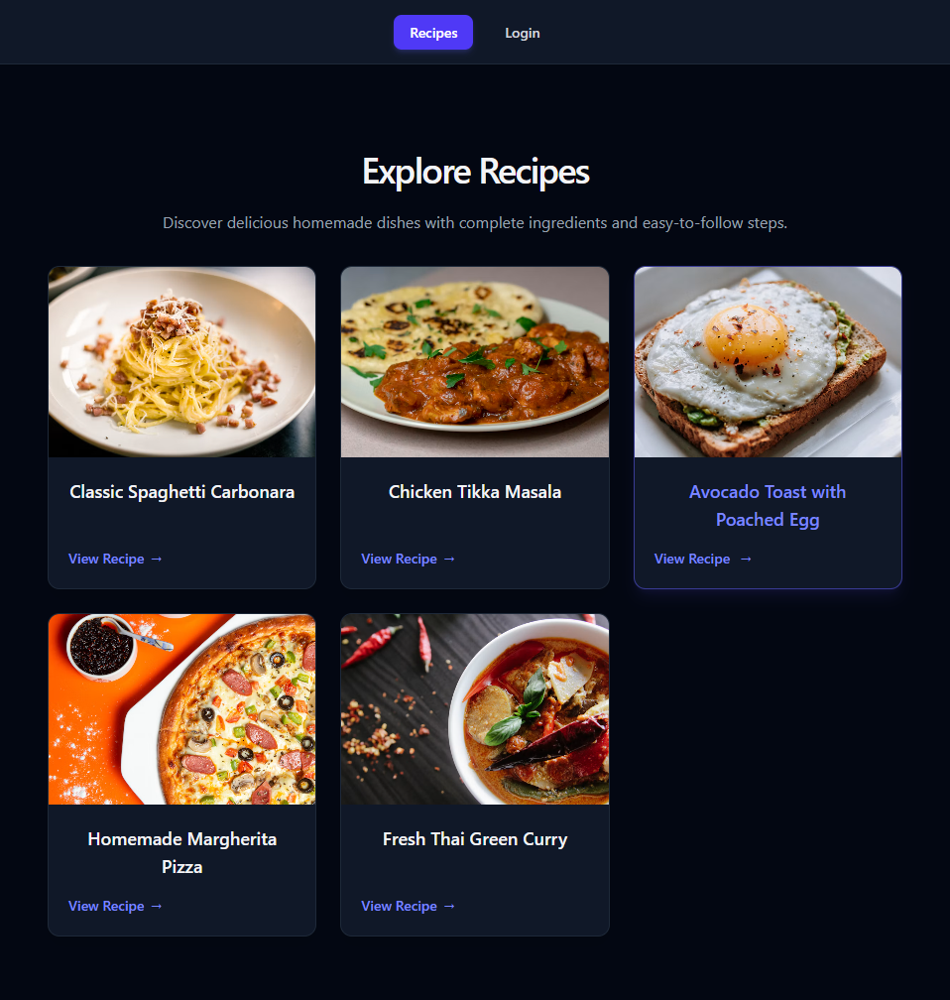

# Recipe Book (React Router practice project)

**[Live demo](https://react-router-recipe-app.vercel.app/)** · Built with React, React Router, and Tailwind CSS · Hosted on Vercel



A small recipe app built to practice the **data router** features of React Router: loaders, actions, deferred data, nested routes, pending UI, lazy-loaded routes, and a simulated client-side authentication flow with protected routes. Recipes live in an in-memory array, so there is no backend and recipe data resets on page refresh.

> **Note:** authentication here is a front-end simulation for practice. See [Authentication](#authentication) and [Known limitations](#known-limitations-by-design).

## Try it

Open the [live demo](https://react-router-recipe-app.vercel.app/), then:

1. Browse the recipes and open one to see its ingredients and steps.
2. Sign up from the **Login** link (any email and a password of the minimum length works, since accounts are stored only in your browser).
3. Add a new recipe, then delete it from its detail page.
4. Refresh on any page, or open a deep link like `/recipes/new` directly. The app still loads, because the host rewrites every path to `index.html`.

## Tech stack

- React (Vite)
- React Router (`createBrowserRouter` / `RouterProvider`)
- Tailwind CSS v4
- Vercel (hosting)

## Getting started

```bash
npm install
npm run dev
```

Open the local URL Vite prints (usually http://localhost:5173).

### Production build

```bash
npm run build     # outputs to dist/
npm run preview   # serves dist/ locally to check the production build
```

## Project structure

```
├── vercel.json               # Rewrites every path to index.html (SPA routing)
└── src/
    ├── main.jsx                  # App entry
    ├── App.jsx                   # Router definition (all routes live here)
    ├── data.js                   # In-memory recipe "database"
    ├── index.css                 # Tailwind import + global styles
    ├── actions/
    │   ├── recipeAction.js       # newRecipeAction, deleteRecipeAction (both require auth)
    │   └── authActions.js        # authAction (login + signup), logoutAction
    ├── loaders/
    │   └── RecipeLoaders.js      # recipesLoader, recipeDetailLoader (500ms simulated delay)
    ├── utils/
    │   ├── auth.js               # Token + accounts helpers, tokenLoader, requireAuth
    │   └── NavLinkClasses.js     # Shared NavLink class builder
    ├── components/
    │   ├── MainNav.jsx           # Top navigation, changes with login state
    │   ├── AuthForm.jsx          # Login / signup form (mode from ?mode= query param)
    │   ├── Recipe.jsx            # Recipe card
    │   └── LoadingSpinner.jsx    # Suspense fallback
    └── pages/
        ├── RootLayout.jsx        # Shared layout with <Outlet />
        ├── ErrorPage.jsx         # errorElement (404 vs generic error)
        ├── Authentication.jsx    # Page wrapper around AuthForm (lazy loaded)
        ├── RecipesPage.jsx       # List page
        ├── RecipeDetailsPage.jsx # Detail page, tabs, delete button (logged-in only)
        ├── Ingredients.jsx       # Nested index route
        ├── Steps.jsx             # Nested route
        └── NewRecipe.jsx         # Form page (protected, lazy loaded)
```

## Routes

| Path                       | Component                                   | Loader               | Action                                   |
| -------------------------- | ------------------------------------------- | -------------------- | ---------------------------------------- |
| `/` (root layout)          | `RootLayout`                                | `tokenLoader`        | none                                     |
| `/` (index)                | `RecipesPage`                               | `recipesLoader`      | none                                     |
| `/auth?mode=login\|signup` | `AuthenticationPage` (`AuthForm`), **lazy** | none                 | `authAction` (login or signup)           |
| `/logout`                  | none                                        | redirects to `/`     | `logoutAction`                           |
| `/recipes/new`             | `NewRecipe` (**protected**, **lazy**)       | `requireAuth`        | `newRecipeAction` (create)               |
| `/recipes/:recipeId`       | `RecipeDetailsPage` + `Ingredients` (index) | `recipeDetailLoader` | `deleteRecipeAction` (delete, protected) |
| `/recipes/:recipeId/steps` | `RecipeDetailsPage` + `Steps`               | inherited            | inherited                                |

The root route has `id: "root"` so any component can read its loader data (the auth token) with `useRouteLoaderData("root")`.

## Code splitting

The routes that aren't needed on first paint use the route-level `lazy` property, so their code (component, loader, and action together) downloads only when the user visits them:

- `/auth`
- `/recipes/new`

The root layout, navigation, error page, and recipes list stay in the main bundle because they are needed immediately. After `npm run build`, the extra files in `dist/assets/` are the lazy chunks. You can see them load on demand in the browser's Network tab.

## Deployment

The app is a client-side SPA, so the host must return `index.html` for any path that isn't a real file. Otherwise refreshing or opening a deep link like `/recipes/new` would return a 404 instead of letting React Router handle the route. `vercel.json` handles this:

```json
{
  "rewrites": [{ "source": "/(.*)", "destination": "/index.html" }]
}
```

Vercel serves real files (JS, CSS, images) first, so only unmatched paths hit the rewrite.

To deploy your own copy:

1. Push the repo to GitHub.
2. On [vercel.com](https://vercel.com), choose **Add New → Project** and import the repo.
3. Keep the detected settings: **Framework Preset:** Vite, **Build Command:** `npm run build`, **Output Directory:** `dist`.
4. Click **Deploy**. Every push to the main branch redeploys automatically.

## Authentication

A simulated flow built entirely with data router features, no extra libraries:

- **Signup and login share one form.** `AuthForm` reads `?mode=login` or `?mode=signup` with `useSearchParams`; `authAction` reads the same param from `request.url`. A missing mode defaults to login in both places.
- **Accounts** are stored in `localStorage` under `accounts` (email + password). Emails are trimmed and lowercased. Signup requires a minimum password length, matching confirmation, and a unique email. Login returns the same generic error for an unknown email and a wrong password.
- **Session** is a random token stored in `localStorage` under `token`.
- **`tokenLoader`** runs on the root route and exposes the token. After any action (login, logout), React Router revalidates loaders, so the nav and the delete button update without manual state.
- **`requireAuth`** throws a `redirect` to `/auth?mode=login` when there is no token. It is used as the loader of `/recipes/new` and at the top of both recipe actions, so mutations are blocked even if the UI is bypassed.
- **UI follows login state**: logged-out users see only "Recipes" and "Login" in the nav and no delete button; logged-in users also see "Add New Recipe" and "Logout".

## Concepts practiced

- **Data router setup**: `createBrowserRouter`, `RouterProvider`
- **Layout routes and nesting**: `RootLayout` with `<Outlet />`, index routes, pathless/grouped children (`recipes`)
- **Dynamic segments**: `:recipeId` and `params` in loaders/actions
- **Loaders**: fetching data before render, returning promises
- **Deferred data**: `<Suspense>` + `<Await>` with a loading fallback
- **Actions**: `<Form method="post">`, `request.formData()`, `redirect()` after success
- **Action feedback**: `useActionData` (validation errors), `useNavigation` (submitting state)
- **Fetchers**: `useFetcher` + `fetcher.Form method="delete"` for a mutation that doesn't navigate until the action redirects
- **Error handling**: `errorElement`, `useRouteError`, `isRouteErrorResponse`, throwing `Response` with a status
- **Navigation UI**: `NavLink` with `isActive` styling, `Link`
- **Sharing data with child routes**: `useOutletContext`
- **Route IDs and shared loader data**: `id: "root"` + `useRouteLoaderData`
- **Route protection**: throwing `redirect` from loaders and actions (`requireAuth`)
- **Query-param driven UI**: `useSearchParams` to switch between login and signup
- **Logout without a page**: a route with only an `action` and a redirecting `loader`
- **Code splitting**: lazy-loaded routes with the `lazy` route property
- **SPA deployment**: production build, hosting on Vercel, and rewrite rules so deep links and refreshes work

## Known limitations (by design)

- Recipe data is stored in memory only; refreshing the page restores the original recipes.
- **Authentication is not secure.** Passwords are stored in plain text in `localStorage`, and the token is a random string that is never validated by a server. Anyone can set a `token` in DevTools. Real authentication needs a backend that verifies credentials and issues signed tokens.
- Tokens never expire, and logging out in one tab does not update other open tabs.
- Recipes are not tied to users: any logged-in user can delete any recipe.
- Loaders and the delete action include artificial delays so loading/pending states are visible. Remove them when you're done experimenting.

## Practice ideas (next steps)

1. **Edit recipe**: add `/recipes/:recipeId/edit` with its own loader and action. Reuse the form from `NewRecipe` and use a hidden `intent` field to tell create from update.
2. **Search and filter**: add a search box on the list page using `useSearchParams` and read `new URL(request.url).searchParams` inside `recipesLoader`. Use `<Form method="get">`.
3. **Favorites with optimistic UI**: a heart button using `useFetcher` that reads `fetcher.formData` to update instantly before the action finishes.
4. **Per-route error handling**: give the detail route its own `errorElement` and use `<Await errorElement={...}>` for deferred failures.
5. **`useRouteLoaderData`** for recipes: replace `useOutletContext` in `Ingredients`/`Steps` and compare the two approaches.
6. **Return to the intended page after login**: have `requireAuth` redirect to `/auth?mode=login&redirectTo=...` and read it in `authAction`.
7. **Guard `/auth` for logged-in users**: add a loader that redirects to `/` when a token already exists.
8. **Token expiry**: store an expiration time with the token and treat expired tokens as logged out.
9. **Recipe ownership**: save the author's email on each recipe and only allow that user to delete it.
10. **`useNavigate` and `useSubmit`**: add a back button, and auto-submit a filter form on change.
11. **`shouldRevalidate`**: control when the list loader re-runs after actions.
12. **Breadcrumbs with `handle` + `useMatches`**.
13. **Catch-all route** (`path: "*"`) for a custom 404.
